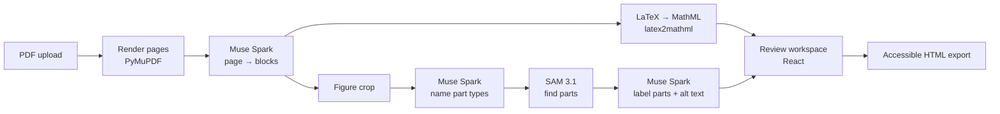

# MathReady

**Turn STEM course PDFs into accessible web pages: equations a screen reader can navigate, and diagrams a blind student can explore.**

Built for the **Meta Global AI Developer Hackathon 2026** with **Muse Spark** and **SAM 3.1** on the Meta Model API.

▶️ **[Watch the 3-minute demo](https://youtu.be/A8dL87ee2Pw)** &nbsp;·&nbsp; Theme: *Build for Your World* &nbsp;·&nbsp; Track: *Indie Developer*


---

## The problem

Most math and science course materials reach students as PDFs. To a screen reader, an equation in a PDF is an image or a jumble of symbols, and a diagram is simply "image." Blind and low-vision students are locked out at the first homework assignment.

It is also now a legal requirement. Under the DOJ's ADA Title II rule, public universities must make course materials meet **WCAG 2.1 AA** by **April 26, 2027** (smaller institutions by April 2028). Existing tools don't solve the math problem:

- **LMS checkers** (such as Anthology Ally) flag issues but handle equations poorly.
- **Free converters** (LaTeXML, Pandoc) need a command line and break on real-world notes.
- **Remediation vendors** charge roughly $4–$15 per page, every time a document changes.
- **Generic PDF-to-HTML converters** keep the visual layout but lose the math. In our test, a common online converter's output could not be read as math by VoiceOver.

## What MathReady does

1. **Upload** a typed or handwritten PDF.
2. **Muse Spark reads every page** into structured content: headings, paragraphs, equations (as LaTeX), tables, and figures.
3. **Equations become MathML**, the web standard for accessible math. Students can hear a whole equation, then step into its parts with a screen reader.
4. **SAM 3.1 finds the parts of each diagram** (force arrows, blocks, axes), and Muse Spark describes each one. The export includes an **explorable diagram**: tabbing through the parts highlights each one on the image while the screen reader reads its description.
5. **A human reviews before anything is published.** Low-confidence equations and every figure description are flagged, and export stays locked until they are approved.
6. **Export** one self-contained, semantic HTML file that works in Canvas, Blackboard, or any course site.

## How we use Meta AI

| Model | Job in MathReady | Why this model |
| --- | --- | --- |
| **Muse Spark** (`muse-spark-1.3`) | Reads each page image into ordered, typed blocks; transcribes equations, including handwriting, into LaTeX with a confidence score | Multimodal reasoning over page images plus the PDF's embedded text |
| **Muse Spark** | Looks at each figure and names the kinds of parts worth exploring (for example `arrow`, `block`, `ramp`) | SAM needs a noun to search for; Spark decides what matters |
| **SAM 3.1** (`sam-3.1`) | Finds every instance of each part and returns precise boxes | Pixel-accurate localization that a language model can't provide |
| **Muse Spark** | Labels each SAM region ("Normal force N, pointing up and away from the ramp") and writes the figure's alt text | Ties SAM's geometry to meaning a student can use |

Each model does what it is best at: **Spark understands, SAM pinpoints.**

## Results

In our testing on typed and handwritten STEM problem sets:

- **94%** of equations were transcribed exactly.
- **86%** of diagram parts were correctly identified.
- Exported pages were verified with **VoiceOver** in Safari: equations are read as math and can be explored term by term, and diagram parts are announced and highlighted one at a time.

Anything the model is unsure about is routed to human review instead of being published silently.

## Architecture



- **Backend:** Python, FastAPI, PyMuPDF, latex2mathml, Pillow, OpenAI-compatible client for the Meta Model API. Documents are processed in the background and saved as JSON, so the review screen fills in page by page.
- **Frontend:** React and TypeScript (Vite). Side-by-side original and accessible views, live MathML previews, per-item approval, and the figure explorer.
- **Export:** semantic HTML with real headings, MathML, captioned tables with header cells, and figures with short alt text, a full description, and an explorable parts list. The images, styles, and script are embedded in a single file.

The app itself is built to be accessible: keyboard navigation throughout, visible focus states, labeled form fields, live status announcements, and reduced-motion support.

## Run it locally

**Requirements:** Python 3.11+, Node 20.19+ (or 22), and a Meta Model API key.

```bash
git clone https://github.com/jason66l/MathReady.git
cd MathReady
cp .env.example .env          # add your META_API_KEY
```

**Backend** (terminal 1):

```bash
python3 -m venv .venv
source .venv/bin/activate
pip install -r backend/requirements.txt
cd backend
uvicorn app.main:app --reload --port 8000
```

**Frontend** (terminal 2):

```bash
cd frontend
npm install
npm run dev
```

Open http://localhost:5173 and upload `samples/ps4.pdf`.

**Quick model checks** (from the repo root):

```bash
python backend/scripts/test_meta.py samples/ps4.pdf 1                      # Muse Spark page reading
python backend/scripts/test_sam.py path/to/figure.png "arrow"              # SAM 3.1 boxes
```

## Project structure

```
backend/
  app/
    main.py          API routes: upload, document, edit block, export
    pipeline.py      PDF → page images → blocks → MathML; figure pipeline
    meta_client.py   Muse Spark calls: read page, list part types, describe figure
    sam.py           SAM 3.1 calls and box parsing
    export.py        accessible HTML builder (MathML, tables, explorable figures)
    store.py         file-based document storage
    config.py        settings from .env
  scripts/           standalone model tests
frontend/
  src/
    pages/           UploadPage, ReviewPage
    components/      BlockCard, FigureExplorer
    api.ts           backend calls
    types.ts         shared data shapes
samples/             test PDF and its LaTeX source
```

## What's next

- **Muse Wonder as a second pass** on pages with low-confidence equations or difficult handwriting.
- **Spoken-text fallback** (`alttext`) for every equation, for screen readers with weaker MathML support.
- **LMS integration** (Canvas, Blackboard) to publish directly to a course.
- **Lecture captioning** with Muse Voice Transcribe, with real math in the captions.
- **Private, on-campus processing** with Meta's open-weight models, for institutions that can't send course material to a hosted API.

## Built during the hackathon

All code in this repository was written during the event (October 26 – November 4, 2026); see the commit history.

Test materials: `samples/ps4.pdf` was created for this project. Additional testing used MIT OpenCourseWare materials (CC BY-NC-SA).

## License

MIT